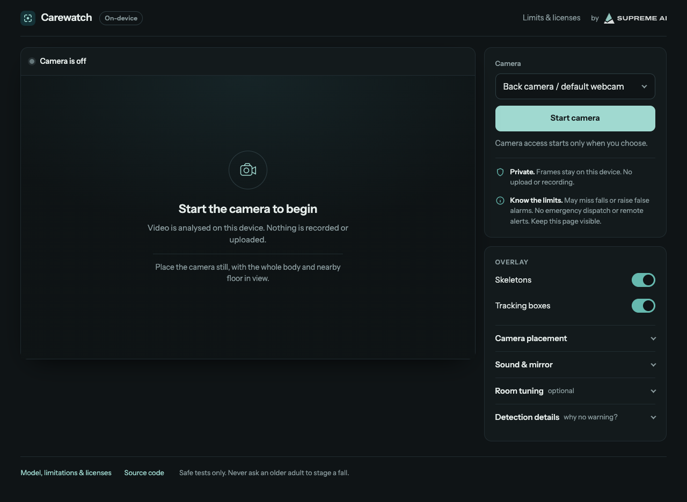

# Carewatch · HumanFallDetection

**Carewatch** is the camera-first, on-device browser application on the
[`browser-v2` branch](https://github.com/manynames3/HumanFallDetection/tree/browser-v2),
with an interface by [Supreme AI Ventures](https://supremeaiventures.dev/).
It adds browser camera access, skeletons and tracking boxes, and local possible-fall
and person-down warnings to a fork of the original MIT-licensed HumanFallDetection research.

[Open the web app](https://carewatch-v2.pages.dev/) ·
[Browser implementation guide](BROWSER_V2.md) ·
[Improvements, evidence and limitations](docs/reliability-history.md) ·
[C4 architecture](docs/architecture.md) ·
[Architecture decision](docs/adr/0001-browser-v2-on-device-inference.md)

> Not validated for safety monitoring. It can miss falls and raise false alarms.
> It does not confirm impact, contact caregivers, or dispatch emergency help.
> Never substitute it for normal care or an emergency system.

## Choose the right branch

| Branch | What it contains | Start here |
| --- | --- | --- |
| [`browser-v2`](https://github.com/manynames3/HumanFallDetection/tree/browser-v2) | Carewatch: static HTML/CSS/JavaScript app, MediaPipe browser pose estimation, retained LSTM port, separate person-down rules, Supreme AI Ventures branding. Also retains upstream Python files and license. | [Browser setup below](#run-carewatch-locally), [BROWSER_V2.md](BROWSER_V2.md) |
| [`master`](https://github.com/manynames3/HumanFallDetection/tree/master) (default branch) | Original Python/OpenPifPaf/PyTorch research track with multi-camera/multi-person processing. Not the Carewatch web app. | [Original research setup below](#original-python-research-project), [upstream project](https://github.com/taufeeque9/HumanFallDetection) |

If the repository opens on `master`, switch to **`browser-v2`** for the web app.
Python research capabilities and results must not be assumed to apply to the browser version.

## Browser interface



Local `browser-v2` preview, camera off. This screenshot shows the interface and branding,
not a fall-detection test or an accuracy result.

## What the browser version does

- Requests video permission only after **Start camera**; no login or microphone access.
- Runs pose estimation and the retained classifier on your device in a browser worker.
- Shows per-person skeletons and tracking boxes with independent display toggles.
- Adds rule-based standing/sitting-to-down and sustained person-down warnings, separate
  from the original LSTM. Room marking is optional; bed/sofa exclusions and floor regions
  can be drawn when needed and last only for the current session.
- Provides a visible local warning and optional local sound. Diagnostics explain
  pose quality, movement-history progress and warning-blocking reasons.
- Sends no camera frames or predictions to a server and makes no recordings.
  The static host still receives normal page/model-asset requests and may retain access logs.

**Camera-agnostic means browser-accessible cameras**, not every network video source.
Phone cameras, built-in webcams and connected USB webcams must be exposed by the
browser's camera API. Compatibility, placement and device performance matter.
Direct RTSP/IP-camera ingestion, concurrent multi-camera capture and cross-camera identity
matching are not implemented in this browser version; no proprietary camera SDK is required.

### Safety and operating limits

Keep the camera still with the whole body and nearby floor visible. Detection stops
when the page is hidden, a tab is switched, or the session ends; phone locking or OS
suspension can also stop it. This is **not unattended 24/7 monitoring**.

Tracking is not proof of safety. Posture labels and red warnings are predictions, not
confirmed falls. Intentional lying on a bed, sofa or floor, occlusion, blankets, small
or partial bodies, multiple people, and camera movement can cause misses or false warnings.
Incorrect exclusion regions can suppress a real event. Classifier scores are not
calibrated probabilities. There are no remote notifications, contact escalation or
emergency-service integrations.

Replacing OpenPifPaf with MediaPipe changes the perception pipeline. Upstream published
accuracy does **not** transfer to this adaptation, and neither passing unit tests nor
overlay screenshots establish real-world reliability. Safely staged tests should involve
capable, consenting adults only; never ask an older adult to stage a fall.

## Run Carewatch locally

Use the `browser-v2` branch and Node.js 22 (the CI version). Python is only used below
to serve the static files; you do not need the upstream Python ML dependencies to run the web app.

```sh
git switch browser-v2
npm ci
npm test
npm run build
python3 -m http.server 8769 --bind 127.0.0.1
```

Open **http://localhost:8769/browser/**. Camera access requires a supported browser,
permission, and a secure context: localhost works for development; use HTTPS on other
devices. Opening files directly or visiting a plain-HTTP LAN address is not a supported
camera setup. The build packages self-hosted runtime/model assets and verifies model hashes.

Cloudflare Pages serves **`browser/`** with build command **`npm run build`**. It hosts
static files, not video inference. Do not publish the repository root or the local test
server/fixtures. See [BROWSER_V2.md](BROWSER_V2.md) for build and release details.
Documentation changes are not permission to deploy a new detection candidate.

## Architecture and development status

The current browser runtime uses the retained upstream checkpoint plus independent
posture/transition rules. Offline candidate trackers, trained fusion models and recorded-video
benchmarks are development work, **not part of the deployed detector**. They must pass
separate reliability gates before promotion; model names or test counts are not accuracy claims.

- [C4 system context, containers and components](docs/architecture.md)
- [ADR 0001: static, on-device browser inference](docs/adr/0001-browser-v2-on-device-inference.md)
- [Implementation, provenance and QA](BROWSER_V2.md)
- [In-app model, privacy and limitations](browser/about.html)

## Improvements over time

Browser features and offline detection candidates are different tracks. “Implemented”
does not mean a candidate is deployed or its reliability is established.

| Date / phase | What changed and why | Status / lesson |
| --- | --- | --- |
| Oct 2, 2026: browser foundation | Ported the retained MIT classifier to JavaScript; added on-device camera inference, per-person overlays and local warnings without a proprietary camera SDK. | Browser implementation. MediaPipe replaces the upstream pose pipeline, so upstream accuracy does not transfer. |
| Oct 2–3: person-down and transition paths | Added startup-already-down and standing/sitting-to-down checks because observing a skeleton or missing the fall transition must not automatically mean “safe.” Added diagnostics and made room marking optional. | Browser implementation. Posture is not proof of impact or floor contact; intentional lying can warn. |
| Oct 12: interface | Applied Supreme AI Ventures branding, a camera-first layout, independent overlay controls, accessible warning text and collapsed advanced settings. | Browser implementation; visual polish is not detection validation. |
| Oct 12–13: research cycles 1–2 | Built real decoded-video benchmarks, expanded to 359 clips and trained temporal/articulated candidates with grouped data splits. | Some small fresh tests improved, but walking, bed movement, short clips and different views still failed. No candidate promotion. |
| Oct 13: cycles 3–4 | Investigated duplicate poses and identity-reset cascades; added observed-evidence safeguards and compared rule/learned fusion approaches. | A specific lifecycle defect was repaired in research. Broader tracking and missed-fall regressions remained; no promotion. |
| Oct 13: cycle 5 | Made replay resumable and hash-verified; trained native-joint sequence models and tested uninterrupted recordings instead of only isolated clips. | Development gains failed the new continuous-recording test. Frozen models/results retained; no promotion. |
| Oct 13: cycle 6 | Added source-first audit tools, Codex/Claude sampled-frame review, bounded cropped-track/lag controls, actual causal temporal-model training and optimizer/RNG resume tests. | Continuous-development counts improved, but broader false alarms worsened. Controls and higher cutoffs failed the joint gate; no promotion. |

### Latest measured result — not release qualification

The new offline 5,809-parameter temporal convolutional model is compared below with
the frozen native-joint research baseline, **not presented as the live app's model**.

| Previously seen evaluation set | Misses: baseline → new model | False warnings: baseline → new model |
| --- | ---: | ---: |
| EDF continuous recordings, 18 Hz | 44 → 26 of 80 camera-events | 16 → 12 episodes |
| Original 359 clips | 38 → 33 of 176 fall clips | 4 → 12 of 183 ordinary-activity clips |

The EDF rows represent 40 staged falls paired across two views, not 80 independent
falls; reviewed normal exposure is only 9.58 camera-minutes. The new model uses some
EDF participants for fitting, so its aggregate is development evidence. On the seen
participant excluded from fitting/selection, false episodes tie at 18 Hz and worsen
from 2 to 3 at 6 Hz. Walking also regresses. **Deployment remains blocked.**

The [full reliability history](docs/reliability-history.md) documents specific failure
situations, comparable results, why approaches were rejected, what remains unmeasured,
and the distinction between classifier warnings, benchmark episodes and UI notifications.
Passing software tests, a higher confidence cutoff or a successful skeleton overlay
does not replace independent fall/false-alarm evaluation.

### Specific situations to understand

- **Outside-frame, cropped or obscured falls:** the body/floor may be invisible, or
  core joints may disappear just when the person falls. Missing data is not counted
  as positive fall evidence.
- **Walking, crouching, kneeling, bed entry and recovery:** ordinary low movements
  can resemble falling. Optional furniture exclusions can help in a particular room,
  but can also suppress a real fall inside the excluded area.
- **Repeated falls close together:** the benchmark can merge warnings into an earlier
  episode. Recovery-aware event separation and actual notification telemetry are
  still needed; this is not proof that the live UI loses a notification.
- **Already down when the camera starts:** the separate person-down path can warn,
  but cannot establish that an earlier fall occurred or distinguish all intentional lying.
- **Multiple people, low analysis rates and changing views:** identity, pose continuity
  and warnings can change. There is no validated minimum/maximum distance, camera-model
  coverage, night/blanket performance or unattended phone/background monitoring guarantee.

See [situation-specific limitations and evidence](docs/reliability-history.md#situation-specific-limitations)
before interpreting the demo as a monitoring product. The live detector is unchanged
by these research results.

## Original Python research project

The original [HumanFallDetection](https://github.com/taufeeque9/HumanFallDetection)
project by **Mohammad Taufeeque and Samad Koita** augments OpenPifPaf pose estimation
with multi-camera/multi-person tracking and an LSTM. Five temporal/spatial pose features
feed the classifier; the upstream application displays Fall/No Fall decisions.
The original code, checkpoint and MIT notice are retained in this fork.

The visualization below belongs to the **upstream Python research project**, not the
Carewatch browser interface or a validation of its accuracy.

<p align="center"></p>

### Research setup and usage

Run the original research track from `master`, or the retained Python files on this branch.
Use an isolated environment compatible with the legacy pinned dependencies; this documentation
update does not upgrade or qualify that environment.

```sh
python3 -m venv .venv
source .venv/bin/activate
pip install -r requirements.txt
python3 fall_detector.py
```

| Argument | Description | Default |
| --- | --- | --- |
| `--num_cams` | Number of cameras/videos to process. | `1` |
| `--video` | Video path; omit for live capture. For two files named `abc1.xyz` and `abc2.xyz`, use `--num_cams=2 --video=abc.xyz`. | `None` |
| `--save_output` | Save an output video beside the input with `out` prepended to its title. | `False` |
| `--disable_cuda` | Run on CPU instead of using available CUDA. | `False` |

### Upstream dataset and citation

The upstream project used [UP-Fall Detection](https://sites.google.com/up.edu.mx/har-up/)
to train its model. Its [Colab notebook](https://colab.research.google.com/drive/1PbzVZnwBzFK_CcMf5G3dFrjwKZgfK3Vy?usp=sharing)
downloads the dataset and compiles files into videos. These are upstream research resources,
not browser-version performance measurements.

Please cite the original paper when the research contributes to your work:
[Multi-camera, multi-person, and real-time fall detection using long short term memory](https://doi.org/10.1117/12.2580700).

```bibtex
@inproceedings{Taufeeque2021MulticameraMA,
  author = {Mohammad Taufeeque and Samad Koita and Nicolai Spicher and Thomas M. Deserno},
  title = {{Multi-camera, multi-person, and real-time fall detection using long short term memory}},
  volume = {11601},
  booktitle = {Medical Imaging 2021: Imaging Informatics for Healthcare, Research, and Applications},
  organization = {International Society for Optics and Photonics},
  publisher = {SPIE},
  pages = {35 -- 42},
  year = {2021},
  doi = {10.1117/12.2580700},
  URL = {https://doi.org/10.1117/12.2580700}
}
```

## Licenses and attribution

- Upstream code and classifier: [MIT](LICENSE), copyright 2020 Mohammad Taufeeque and
  Samad Koita. Preserve this notice in copies and deployments.
- Browser pose runtime/model: Google MediaPipe, Apache 2.0; the build includes its license.
- Carewatch interface/branding: [Supreme AI Ventures](https://supremeaiventures.dev/).
- Self-hosted Instrument Sans: [SIL Open Font License 1.1](browser/assets/INSTRUMENT-SANS-LICENSE.txt).

Dataset/video licensing and permissions are separate from the code license; do not
assume the MIT license grants rights to all research footage or identifiable people.
