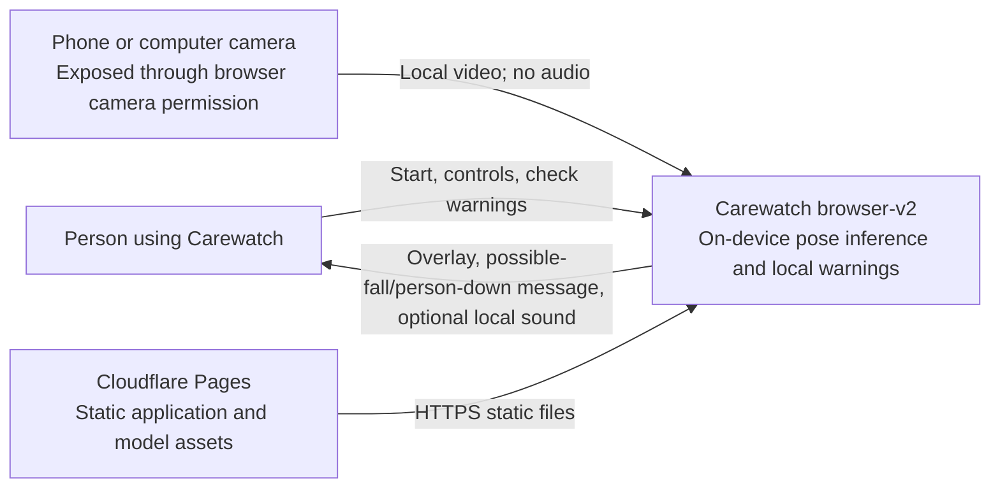
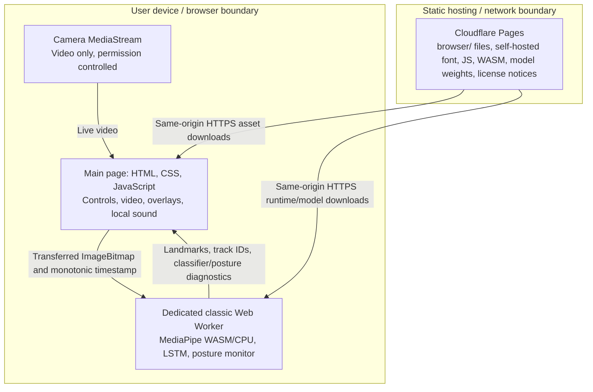
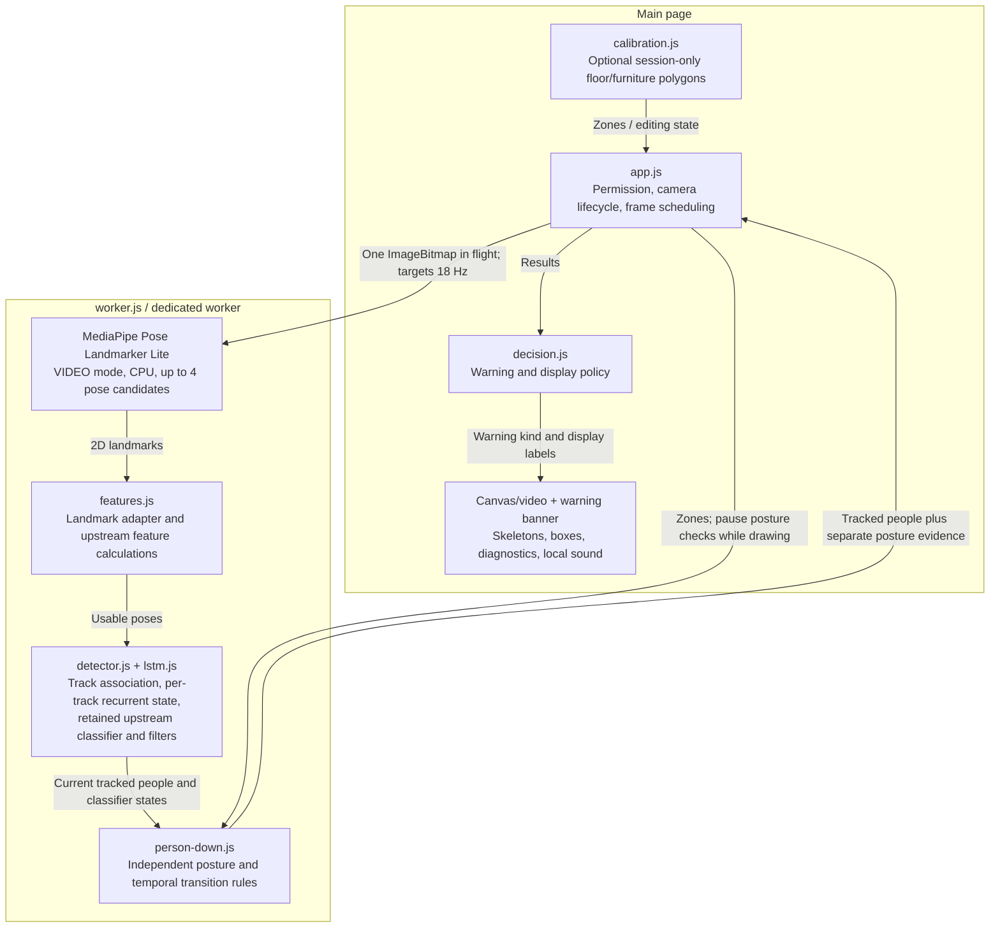

# Carewatch browser-v2 architecture

These C4 views describe the current `browser/` runtime, not the original Python
application or the offline reliability candidates. See [the branch guide](../README.md)
and [ADR 0001](adr/0001-browser-v2-on-device-inference.md) for scope and provenance.

## Level 1: System context

“Camera agnostic” means no required camera brand: the current app accepts cameras
that the phone/computer exposes through `getUserMedia`. It is not a direct RTSP/IP
camera client, a multi-camera service, or a background monitoring service.

## Level 2: Containers and trust boundaries

Camera pixels and inference results stay in browser memory; the runtime has no
frame/prediction upload path, recording store, authentication service, inference
backend, analytics integration, or contact escalation. Hosting still receives
normal asset-request metadata. This is not a promise that hosting traffic is
anonymous or that a compromised device is private.

`browser/_headers` restricts scripts, workers and connections to the same origin;
microphone access is disabled. The worker checks the exported LSTM binary against
its manifest hash. `tools/build.mjs` packages MediaPipe 0.10.32, verifies the Lite
pose-model hash and copies license notices. Build-time downloads are distinct
from runtime camera processing.

## Level 3: Browser components

The upstream MIT LSTM checkpoint is ported to JavaScript without retraining the
production weights. Its MediaPipe landmark adapter replaces upstream OpenPifPaf;
therefore numerical classifier parity does not imply inherited detection accuracy.
The current tracker does not implement upstream cross-camera identity matching.

The separate posture monitor can warn about an already-down person without a
classifier fall prediction. Current defaults are 8 seconds of observed down
evidence, or 2 seconds after a qualifying standing/sitting-to-down transition.
Missing observations add no evidence time. These are algorithm settings, not
validated response-time guarantees; 2D geometry cannot confirm impact or floor
contact. Optional exclusions affect displayed warnings, including classifier
warnings, and can hide a genuine fall if drawn incorrectly.

## Session and safety limits

Stop, page hiding/tab switching, camera changes, camera loss and detector failures
release camera tracks. Session-only room regions are cleared on stop; changed
framing requires a new session and any desired recalibration. The target frame
rate depends on the device and browser. There is no guaranteed monitoring while
the phone is locked, the page is hidden, or the device sleeps.

Skeletons and boxes demonstrate pose tracking, not confirmed fall detection.
Warnings may miss falls or flag intentional lying, bed/sofa movements, occlusion
or poor framing. Local sound is not remote notification or emergency dispatch.
The product must not replace supervision or an emergency-response system; no
clinical sensitivity or false-alarm rate is claimed.

Offline training/evaluation under `tools/` and `tests/` is a development workflow,
not another production container. Candidate models and the newer standalone
tracking experiments are not imported by `browser/worker.js`; their results must
not be presented as capabilities of the current app. This documentation update
does not promote a candidate or deploy a release.
